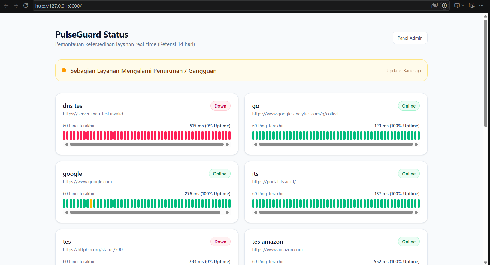
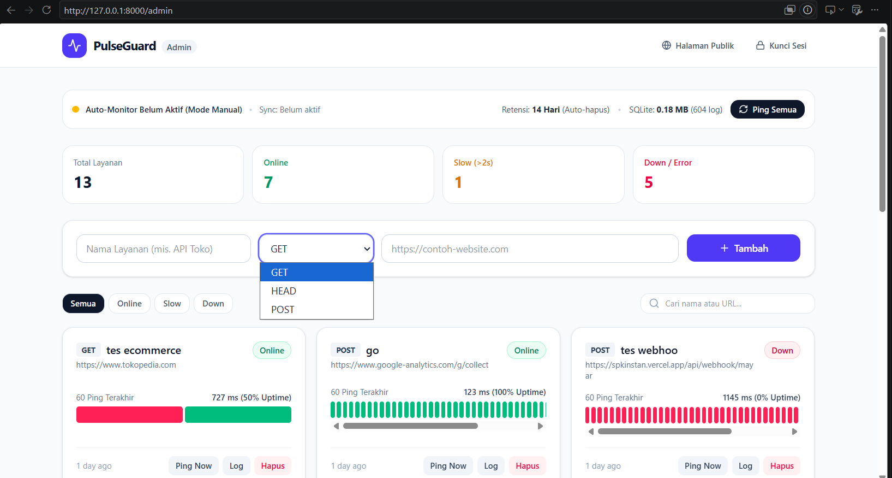
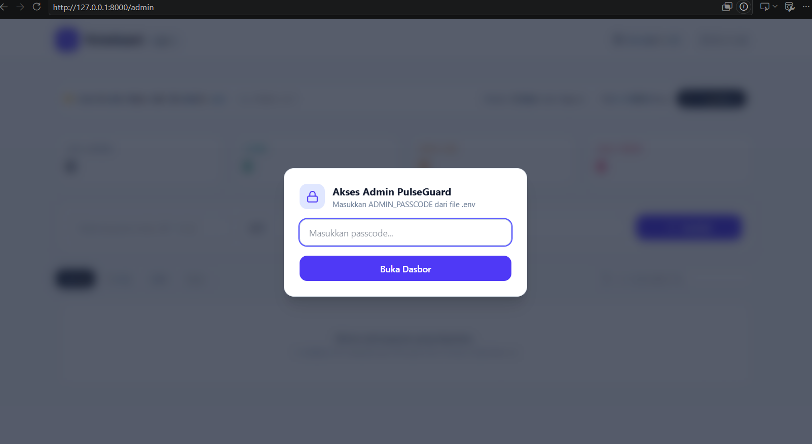

# PulseGuard — Self-Hosted HTTP & Uptime Monitor

**PulseGuard** is a self-hosted HTTP/HTTPS availability (*uptime*) and latency monitoring application for web services and REST APIs, built with **Laravel**, **Vue 3**, and **SQLite**. Designed as a lightweight, self-hosted alternative to paid SaaS monitoring tools (such as UptimeRobot or Pingdom) to check digital assets every 1 minute with zero recurring subscription costs.

---

## Application Preview

### 1. Public Status Page (`/`)
A read-only, login-free status page displaying real-time service health alongside a 60-ping heartbeat visualization.


### 2. Admin Control Dashboard (`/admin`)
A passcode-protected management panel featuring a 1-minute Task Scheduler status indicator, SQLite storage telemetry, status filters, and manual ping triggers.


### 3. Passcode Authentication & Diagnostics
Protected admin access gate and detailed health check inspection, capturing HTTP status codes, response latency (`ms`), and network error diagnostics.


---

## Key Features

- **Multi-Method Monitoring (`GET`, `HEAD`, `POST`):** Supports checking public web pages as well as API/webhook endpoints using browser-like HTTP headers to minimize blocks from standard WAF rules.
- **4-Layer Error Detection:**
  1. *Connection Timeout / Hang* (`cURL error 28`) with a 5-second connection timeout and a 10-second total request timeout.
  2. *DNS & Network Unreachable* (inactive domains or DNS resolution failures).
  3. *HTTP Client & Server Errors* (`4xx` and `5xx` status codes).
  4. *Latency Degradation* automatically flags services as **Slow** when response time exceeds `2,000 ms`.
- **60-Ping Heartbeat Visualization:** Displays the last 60 health checks as an interactive bar chart (hover to inspect timestamp, status, and latency).
- **Public & Admin Access Separation:** The public status page (`/`) is protected by rate limiting, while all write/delete actions under `/admin` are locked behind `ADMIN_PASSCODE` via the `X-Admin-Key` header.
- **Auto-Pruning & SQLite Telemetry:** Automatically prunes ping logs older than 14 days on a daily schedule to keep the SQLite database lightweight, with live storage metrics visible directly on the dashboard.

---

## Engineering Scope

| Aspect | PulseGuard Scope | Out of Scope (Non-Goals) |
| :--- | :--- | :--- |
| **Check Method** | *Black-box* HTTP/HTTPS requests (`GET`, `HEAD`, `POST`) | JavaScript execution (*headless browser* / Playwright) |
| **Server Metrics** | HTTP status codes, network latency (`ms`), & cURL error messages | Target server internal CPU, RAM, or disk usage |
| **Storage** | Local SQLite database with automatic 14-day log retention | Large-scale distributed *time-series databases* |

---

## Tech Stack

- **Backend:** PHP 8.4+, Laravel Framework, Laravel Task Scheduler
- **Frontend:** Vue 3 (Composition API), Tailwind CSS, Vite, Lucide Icons
- **Database:** SQLite

---

## Installation & Local Setup

1. **Clone the repository and navigate into the project directory:**
   ```bash
   git clone [https://github.com/dbbyaulia-arch/pulseguard.git](https://github.com/dbbyaulia-arch/pulseguard.git)
   cd pulseguard
